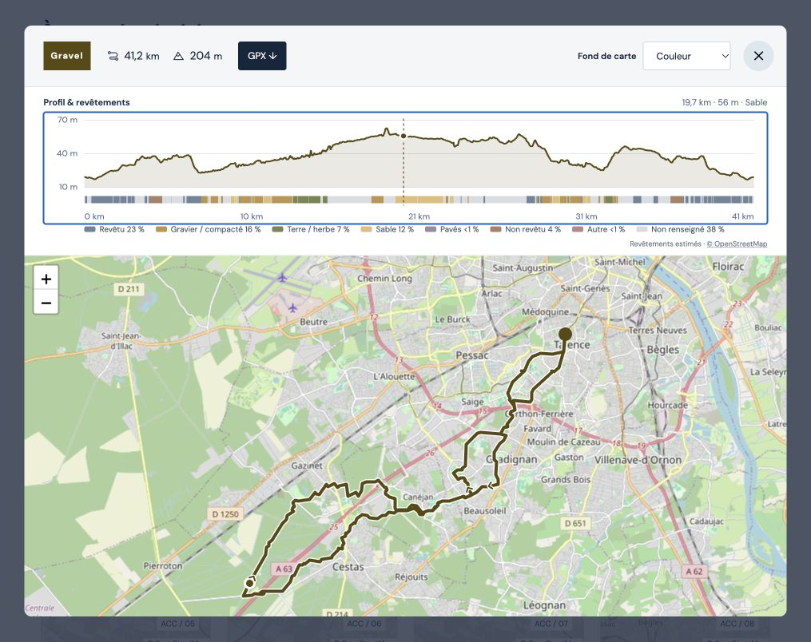

# ACC Bordeaux · Catalogue de parcours

Le catalogue vélo de l’ACC Bordeaux permet de choisir une sortie par pratique, distance et dénivelé, puis d’emporter la trace GPX sur son compteur. La collection de départ réunit **32 parcours route et 22 gravel**. Elle accueille aussi les sorties VTT.



## Explorer le catalogue

- **Choisir une sortie.** La grille donne un aperçu des tracés. La vue liste permet de comparer les kilomètres et le dénivelé et de trier les résultats.
- **Repérer une montée.** Dans la fiche, survoler la carte ou le profil place un repère au même endroit sur les deux vues. Lorsque les données sont disponibles, on peut aussi afficher les revêtements estimés.
- **Emporter le parcours.** L’icône de téléchargement enregistre le GPX de la sortie choisie.

## Ajouter une trace

1. Ouvrir le dossier de la pratique dans le dépôt : [Route](data/gpx/route/), [Gravel](data/gpx/gravel/) ou [VTT](data/gpx/vtt/).
2. Choisir **Add file → Upload files**, déposer le GPX et enregistrer sur `main`.
3. Suivre la publication dans l’onglet **Actions**. Une fois terminée, le parcours est disponible dans le catalogue.

Le nom est attribué à la publication. Par exemple, `08112026_gravel_41km_204d.gpx` correspond à une trace gravel ajoutée le 8 novembre 2026, de 41 km et 204 m de dénivelé positif. Deux fichiers d’une même pratique ayant les mêmes points, segments et sens de parcours donnent une seule entrée.

## Démarrage local

Depuis la racine du dépôt, avec Python 3.12 :

```sh
python3 tools/prepare_site.py
python3 -m http.server 8000 --directory _site
```

Ouvrir [le catalogue local](http://localhost:8000). Après une modification, relancer la préparation pour actualiser `_site/`.

## Fonctionnement et publication

Le site utilise HTML, CSS et JavaScript. Leaflet affiche les traces sur la carte. À chaque publication, Python extrait la collection initiale de `data/parcours.zip`, y ajoute les GPX déposés par le club et génère les profils. GitHub Pages sert ensuite les fichiers statiques, dont chaque GPX individuel.

[Guide de première publication](docs/installation.md) · [Action de publication](.github/workflows/pages.yml) · [Générateur du catalogue](tools/build_catalog.py)

## Tests

La vérification des filtres, du tri et des interactions utilise Node.js 22. Les tests Python couvrent la lecture des GPX, les doublons, la préparation du site et les revêtements.

```sh
node --test tests/app.test.cjs
python3 -m unittest discover -s tools -p 'test_*.py'
```
